<picture>
  <source media="(max-width: 768px)" srcset="https://raw.githubusercontent.com/WidyatamaX/WidyatamaX/main/assets/m/header.svg?v=1" />
  
</picture>

 

 

<picture>
  <source media="(max-width: 768px)" srcset="https://raw.githubusercontent.com/WidyatamaX/WidyatamaX/main/assets/m/section-about.svg?v=1" />
  
</picture>

Halo! I'm **Reza Widya Utama** (`@WidyatamaX`). I build **offline-first software** designed to run reliably without accounts, cloud lock-in, or unnecessary bloat — shipping one clean TypeScript codebase across **Web (PWA)**, **Windows Desktop (Tauri v2)**, and **Android (Capacitor)**.

I enjoy turning complex domain logic — like linear-programming ration optimization or local personal finance tracking — into calm, fast, privacy-respecting tools people can use anywhere.

**🚧 What I'm building**

- 🌾 **[OpenFormu](https://github.com/WidyatamaX/OpenFormu)** — Client-side least-cost feed formulation engine powered by Linear Programming (**HiGHS WebAssembly**). Runs as an installable PWA, native Windows desktop app (Tauri v2), and Android app (Capacitor). · [Live App](https://widyatamax.github.io/OpenFormu/)
- 📒 **[Defisit Harian](https://github.com/WidyatamaX/Defisit-Harian)** — Offline-first personal finance tracker for Android built with React, **Dexie (IndexedDB)**, Capacitor, OHLC candlestick trend charts, and 3 switchable themes — zero cloud, zero tracking.

  
  
  

  
  
  

**🧠 What I'm into**

- 📦 **Local-first & offline-first architecture** — IndexedDB, Dexie, PWA caching, and local JSON backup/restore
- 📱 **Cross-platform delivery** — shipping the same React + TypeScript core to browser, desktop (Tauri/Rust), and Android (Capacitor)
- 🧮 **Client-side optimization & data UI** — WebAssembly solvers (HiGHS) and clean interactive charts
- ✦ **AI-assisted engineering** — building faster and cleaner with **Google Gemini** & **Antigravity**

**⚡ Quick facts**

- 📍 Based in Indonesia 🇮🇩
- ☕ Fueled by coffee, calm focus, and offline-first craftsmanship
- 💬 Ask me about TypeScript, React, Tauri, Capacitor, PWA, or local-first apps
- 🤝 Open to collaborations on open-source tools and practical cross-platform apps

<picture>
  <source media="(max-width: 768px)" srcset="https://raw.githubusercontent.com/WidyatamaX/WidyatamaX/main/assets/m/neofetch.svg?v=1" />
  
</picture>

<picture>
  <source media="(max-width: 768px)" srcset="https://raw.githubusercontent.com/WidyatamaX/WidyatamaX/main/assets/m/divider.svg?v=1" />
  
</picture>

<picture>
  <source media="(max-width: 768px)" srcset="https://raw.githubusercontent.com/WidyatamaX/WidyatamaX/main/assets/m/section-journey.svg?v=1" />
  
</picture>

<picture>
  <source media="(max-width: 768px)" srcset="https://raw.githubusercontent.com/WidyatamaX/WidyatamaX/main/assets/m/timeline.svg?v=1" />
  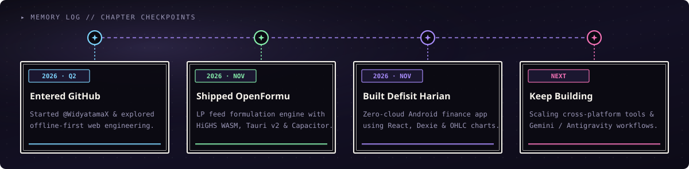
</picture>

<picture>
  <source media="(max-width: 768px)" srcset="https://raw.githubusercontent.com/WidyatamaX/WidyatamaX/main/assets/m/divider.svg?v=1" />
  
</picture>

<picture>
  <source media="(max-width: 768px)" srcset="https://raw.githubusercontent.com/WidyatamaX/WidyatamaX/main/assets/m/section-stack.svg?v=1" />
  
</picture>

<picture>
  <source media="(max-width: 768px)" srcset="https://raw.githubusercontent.com/WidyatamaX/WidyatamaX/main/assets/m/marquee.svg?v=1" />
  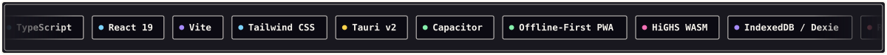
</picture>

<picture>
  <source media="(max-width: 768px)" srcset="https://raw.githubusercontent.com/WidyatamaX/WidyatamaX/main/assets/m/stack.svg?v=1" />
  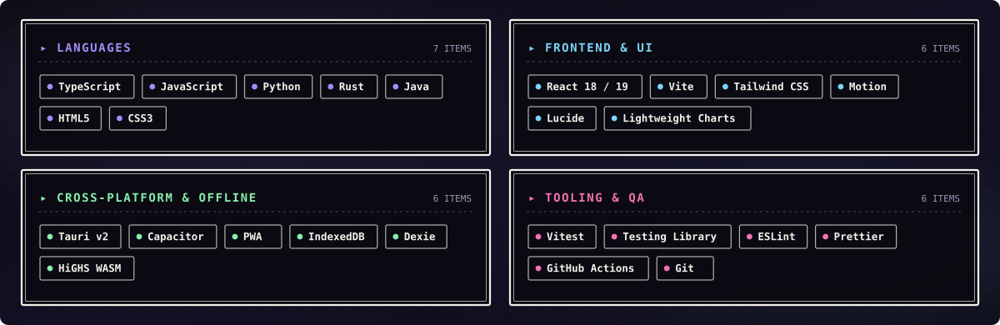
</picture>

<picture>
  <source media="(max-width: 768px)" srcset="https://raw.githubusercontent.com/WidyatamaX/WidyatamaX/main/assets/m/section-ai.svg?v=1" />
  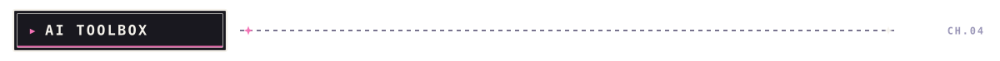
</picture>

<picture>
  <source media="(max-width: 768px)" srcset="https://raw.githubusercontent.com/WidyatamaX/WidyatamaX/main/assets/m/ai-orbit.svg?v=1" />
  
</picture>

<picture>
  <source media="(max-width: 768px)" srcset="https://raw.githubusercontent.com/WidyatamaX/WidyatamaX/main/assets/m/divider.svg?v=1" />
  
</picture>

<picture>
  <source media="(max-width: 768px)" srcset="https://raw.githubusercontent.com/WidyatamaX/WidyatamaX/main/assets/m/section-stats.svg?v=1" />
  
</picture>


 

 

### 🌌 3D Contribution Graph

<picture>
  <source media="(prefers-color-scheme: dark)" srcset="https://raw.githubusercontent.com/WidyatamaX/WidyatamaX/output/profile-night-rainbow.svg" />
  <source media="(prefers-color-scheme: light)" srcset="https://raw.githubusercontent.com/WidyatamaX/WidyatamaX/output/profile-season-animate.svg" />
  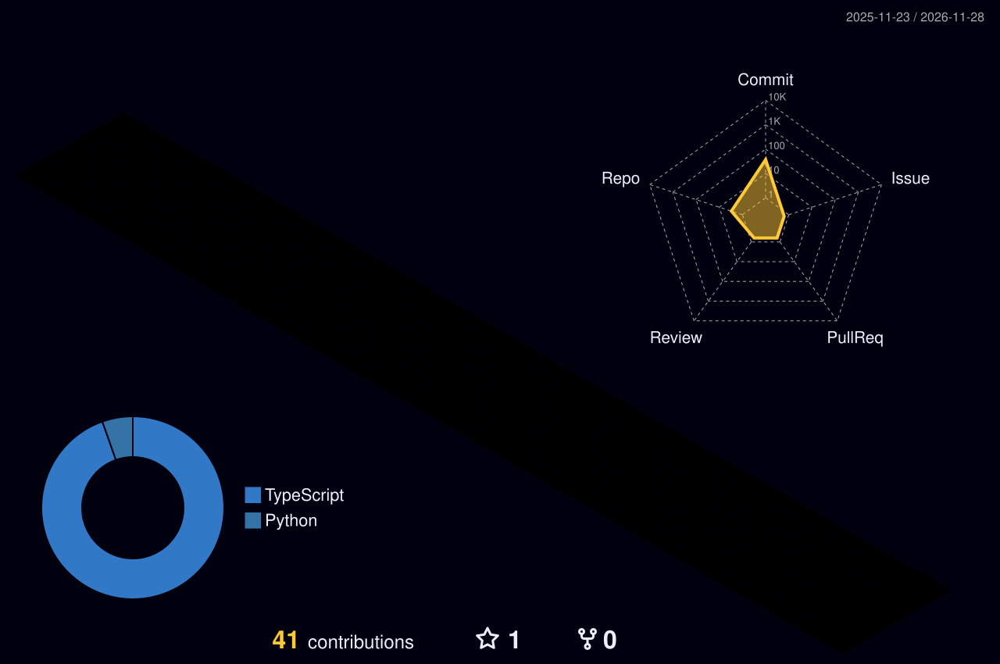
</picture>

### 🐍 Contribution Snake

<picture>
  <source media="(prefers-color-scheme: dark)" srcset="https://raw.githubusercontent.com/WidyatamaX/WidyatamaX/output/github-snake-dark.svg" />
  <source media="(prefers-color-scheme: light)" srcset="https://raw.githubusercontent.com/WidyatamaX/WidyatamaX/output/github-snake.svg" />
  
</picture>

<picture>
  <source media="(max-width: 768px)" srcset="https://raw.githubusercontent.com/WidyatamaX/WidyatamaX/main/assets/m/footer.svg?v=1" />
  
</picture>
